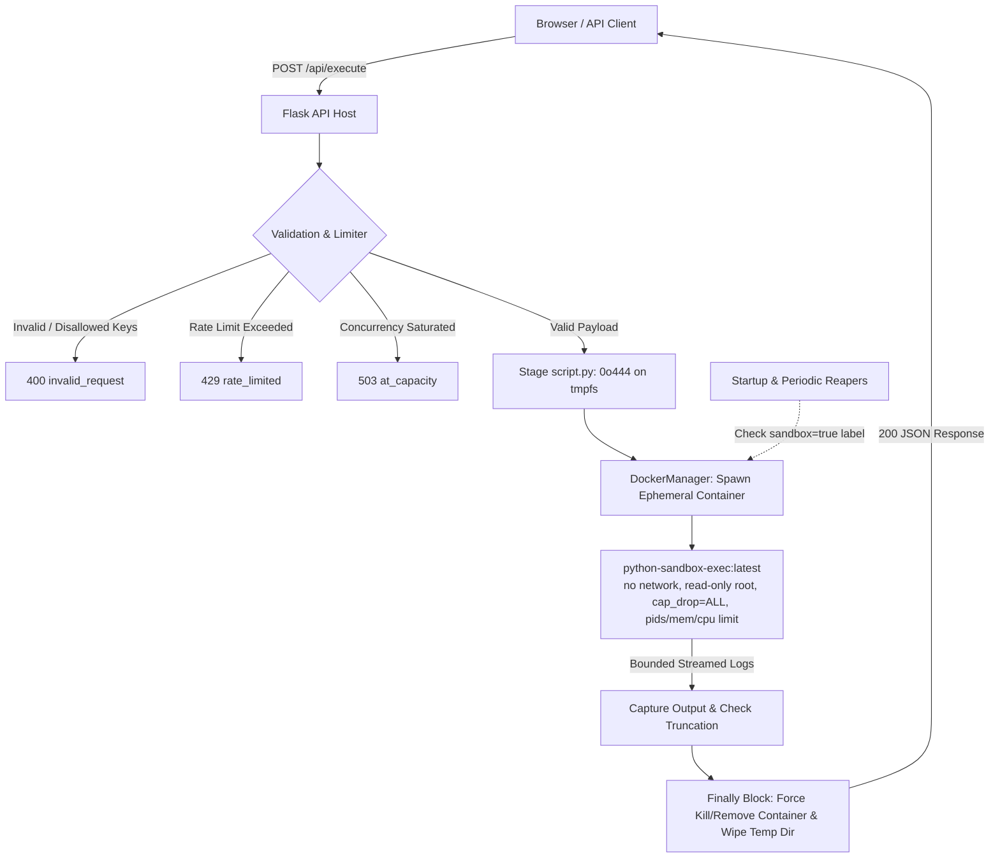

# Python Code Execution Sandbox

> The repository now also exposes an integration and assessment API at `/api/v1`. The original editor and `/api/execute` sandbox remain available.

[]()
[]()
[]()
[]()

A high-performance, production-grade Python Code Execution Sandbox engine. Designed with a strict threat model and multi-layered defense-in-depth isolation, it securely executes arbitrary, untrusted Python source code in ephemeral, resource-constrained Docker containers.

---

## Architecture



## Integration and assessment service

The integration layer is implemented as a separate Flask blueprint and calls the same `SandboxExecutor` used by the standalone editor. The `/api/v1` routes never accept Docker options from callers. The existing `/api/execute` contract is unchanged.

### Local bootstrap

1. Configure a strong random `FLASK_SECRET_KEY` in `.env`. Keep `.env` out of source control.
2. Start the API as before (`python run.py`, with Docker and the sandbox image available).
3. Create an organization and one-time API key with `flask --app run.py provision-organization`. The credential has the initial integration scopes and its plaintext is shown once. Store it securely.
4. Set `INTEGRATION_DATABASE` to a writable SQLite file path if you want to relocate the default `instance/integration.sqlite3` database.

Use `Authorization: Bearer <api-key>` for machine-to-machine calls. Candidate session creation returns a short-lived signed candidate token; use it only for that candidate's submission and result calls. API keys are high-entropy, hashed with SHA-256 at rest, scoped, and revocable. The organization ID is always derived from the authenticated credential or signed session.

### Versioned endpoints

| Method | Path | Scope / caller |
|---|---|---|
| GET | `/api/v1/health` | Public liveness |
| POST, GET | `/api/v1/executions`, `/api/v1/executions/{id}` | `executions:write`, `executions:read` |
| POST, GET | `/api/v1/exams`, `/api/v1/exams/{id}` | `exams:write`, `exams:read` |
| POST | `/api/v1/exams/{id}/status` | `exams:write` (server-checked lifecycle transition) |
| POST, GET | `/api/v1/exams/{id}/sessions`, `/api/v1/exams/{id}/sessions/{session_id}` | `sessions:write`, `sessions:read` |
| POST | `/api/v1/exams/{id}/submissions` | Candidate session token |
| GET | `/api/v1/submissions/{id}` | Owning candidate token or `submissions:read` |
| GET | `/api/v1/integrations/me` | Any valid credential |
| DELETE | `/api/v1/integrations/credentials/{id}` | `credentials:write` |
| GET | `/api/v1/audit-events` | `audit:read` |
| POST | `/api/v1/proctoring/events` | `proctoring:write` |

Example direct execution:

```python
import requests
r = requests.post("https://sandbox.example.edu/api/v1/executions",
    headers={"Authorization": "Bearer " + api_key},
    json={"code": "print('Hello')", "language": "python"}, timeout=10)
r.raise_for_status()
print(r.json())
```

Exam creation accepts title, description, optional ISO-8601 availability timestamps, `allowed_languages: ["python"]`, resource limits bounded by the platform defaults, and public/hidden tests represented as `[{"expected_stdout":"..."}]`. Example:

```javascript
const response = await fetch("https://sandbox.example.edu/api/v1/exams", {
  method: "POST",
  headers: { "Authorization": `Bearer ${apiKey}`, "Content-Type": "application/json" },
  body: JSON.stringify({ title: "Loops", hidden_tests: [{ expected_stdout: "done\\n" }] })
});
```

Move exams through draft → scheduled → active → completed (or cancelled) using the status endpoint. Session creation takes `external_candidate_reference` and is allowed only while an exam is active. The API returns `candidate_token` once; use it as a bearer token to submit `{"code":"...","language":"python"}`. Pass `Idempotency-Key` to safely retry a submission. Errors use `{ "error": { "code", "message", "request_id" } }`.

### Embed demonstration

Visit `/demo/university` for a simulated LMS embedding the retained editor at `/embed/editor`. This page is labeled as simulated and is not connected to real candidates, sessions, or grades. To permit your LMS origin to frame the editor, configure `EMBED_ALLOWED_ORIGINS` as a comma-separated list of exact trusted origins (scheme and host) and serve both systems over HTTPS. The main editor route remains protected from framing.

### Current limits and security boundary

- Integration records currently use Python's built-in SQLite database for a zero-dependency local setup. This implementation does not yet provide PostgreSQL/SQLAlchemy models, Alembic migrations, or production multi-instance database deployment. Use a single API instance for this version; migrate the store before horizontal scaling.
- The synchronous API uses the existing bounded execution semaphore and per-IP Flask-Limiter. Organization-specific distributed quotas and asynchronous queues are not yet implemented. A scoped API endpoint accepts validated, timestamp-checked, replay-protected proctoring event IDs; provider-specific webhook adapters and signature schemes remain future work.
- Hidden expected output is held server-side and never appended to the candidate's source. The current minimal scorer compares one run's stdout with configured expected-output cases; it does not provide parameterized input/output test execution. Use an isolated assessment worker design before relying on complex hidden tests.
- The CLI provisions initial credentials; credential revocation is available through the API. Dedicated organization administration pages and credential rotation UI are not included yet.
- Execution isolation does not prevent tab switching, external-device use, collaboration, unauthorized AI assistance, or every form of cheating. No webcam, microphone, or screen recording is performed. Browser focus signals and any future provider flags need context and institutional privacy review.
- The Docker daemon remains a privileged dependency of the trusted orchestrator. User-code containers receive no Docker socket and run with the configured resource/security controls. The 50 MB / three-second defaults need workload validation; consider gVisor, Firecracker, or dedicated worker hosts for higher-risk public use.

The current service keeps exam policies and data organization-scoped, uses server-side expiry checks, avoids returning hidden test definitions, and records core credential, exam, session, execution, and assessment audit events. Review the known limits above before production use.

---

## Technology Stack

- **Backend Framework**: Python 3, Flask 3.1, Gunicorn
- **Orchestration & Containerization**: Docker SDK for Python (`docker-py`), Docker Engine
- **Concurrency & Rate Limiting**: Python Threading Semaphores, Flask-Limiter, Redis
- **Frontend IDE**: Vanilla JavaScript, Monaco Editor with responsive `<textarea>` line-number gutter fallback
- **Testing**: Pytest, Pytest-Mock

---

## Security Model & Threat Mitigation

User-submitted code is **always treated as hostile**. The platform implements layered defense-in-depth:

| Security Vector | Implementation & Controls |
| :--- | :--- |
| **No Host Execution** | User code is **never** executed using `exec()`, `eval()`, or host subprocess. All execution occurs inside dedicated containers. |
| **Two-Image Model** | The trusted Flask API image interacts with Docker. The execution container image (`python-sandbox-exec:latest`) is completely unprivileged. |
| **Non-Root Execution** | Sandboxed containers run as a dedicated, non-root `sandbox:sandbox` user created without a shell or home directory. |
| **Network Isolation** | `network_mode="none"` blocks all egress and ingress network connections (sockets, HTTP/HTTPS, DNS). |
| **Filesystem Lockdown** | `read_only=True` enforces an immutable root filesystem. A size-capped (16MB) `tmpfs` is mounted at `/tmp` with `noexec,nosuid,nodev`. |
| **Capability Dropping** | `cap_drop=["ALL"]` drops all Linux kernel capabilities. `no-new-privileges:true` prevents privilege escalation. |
| **Memory Exhaustion** | Strict memory limit (`MEMORY_LIMIT=50m`). Swap is disabled by matching `MEMSWAP_LIMIT=50m` (preventing swap amplification attacks). |
| **Fork Bombs & Threads** | `PIDS_LIMIT=64` stops thread and fork bombs immediately. |
| **CPU Saturation** | `CPU_NANO=500000000` caps CPU usage to 0.5 vCPU. |
| **External Watchdog** | Bounded timeouts via `ThreadPoolExecutor` and Docker API wait prevent container hangs from locking worker threads. |
| **Unbounded Output Cap** | Log streaming terminates at `MAX_OUTPUT_SIZE=65536` bytes with a truncation marker, preventing memory exhaustion. |
| **Secret Sanitization** | Sandboxed containers receive an explicitly empty environment (`environment={}`). Host environment variables and secrets are never passed. |
| **Strict Request Validation** | Non-string code, oversized payloads, NUL bytes (`\x00`), and client-injected Docker configs are rejected before staging. |
| **Orphan Container Reapers** | Startup reaper wipes crash leftovers; periodic background reaper thread purges containers exceeding execution timeouts. |

---

## Residual Risks & Stronger Isolation

> [!WARNING]
> While Docker namespaces and cgroups provide robust containerization, shared-kernel container environments have residual risks:
> - **Kernel-Level Vulnerabilities**: Linux kernel zero-days or cgroup exploits could breach standard runc isolation.
> - **Microarchitectural Side-Channels**: Speculative execution timing (Spectre/Meltdown) across CPU cores.
> 
> **Recommendations for High-Security Multi-Tenant Deployments**:
> 1. **gVisor (`runsc`)**: The codebase includes automatic detection for gVisor. If `runsc` is installed on your Docker host, the sandbox automatically selects `runtime="runsc"`, providing user-space kernel syscall interception.
> 2. **MicroVMs (Firecracker / Kata Containers)**: For multi-tenant hosting, consider wrapping execution inside lightweight Firecracker microVMs.

---

## Configuration Reference

All settings can be customized via `.env` or environment variables:

| Env Variable | Type | Default | Description |
| :--- | :--- | :--- | :--- |
| `EXECUTION_TIMEOUT` | int (sec) | `3` | Hard wall-clock limit per execution |
| `TIMEOUT_GRACE_PERIOD` | int (sec) | `2` | Extra time allowed for kill/remove before API gives up |
| `MEMORY_LIMIT` | str | `50m` | Docker container memory limit |
| `MEMSWAP_LIMIT` | str | `50m` | Must equal `MEMORY_LIMIT` to disable swap |
| `CPU_NANO` | int | `500000000` | CPU quota in nano_cpus (0.5 vCPU) |
| `PIDS_LIMIT` | int | `64` | Maximum processes/threads inside container |
| `TMPFS_SIZE` | str | `16m` | Size cap for container writable `/tmp` |
| `MAX_CODE_SIZE` | int (bytes) | `32768` | Maximum accepted source code size |
| `MAX_CODE_LINES` | int | `1000` | Maximum source code line count |
| `MAX_OUTPUT_SIZE` | int (bytes) | `65536` | Combined stdout + stderr cap before truncation |
| `MAX_CONCURRENT_EXECUTIONS` | int | `10` | Concurrency semaphore limit; excess gets 503 |
| `RATE_LIMIT` | str | `20/minute` | Per-IP rate limit via Flask-Limiter |
| `RATE_LIMIT_STORAGE_URI` | str | `memory://` | Limiter storage (`redis://...` for production) |
| `EXECUTION_IMAGE` | str | `python-sandbox-exec:latest` | Tag of pre-built hardened execution image |
| `STAGING_ROOT` | str | `/dev/shm/sandbox` | File staging root (`/dev/shm` tmpfs or fallback) |
| `DOCKER_TIMEOUT` | int (sec) | `10` | HTTP client timeout for Docker SDK calls |

---

## API Specification

### 1. Execute Code
`POST /api/execute`

**Request Body:**
```json
{
  "code": "print('Hello World')\n"
}
```

**Success Response (`200 OK`):**
```json
{
  "success": true,
  "execution_id": "8f3e2b1a9c0d4e5f6a7b8c9d0e1f2a3b",
  "status": "completed",
  "stdout": "Hello World\n",
  "stderr": "",
  "exit_code": 0,
  "execution_time_ms": 142,
  "truncated": false
}
```

**Timeout Response (`200 OK`):**
```json
{
  "success": false,
  "execution_id": "8f3e2b1a9c0d4e5f6a7b8c9d0e1f2a3b",
  "status": "timeout",
  "error": "Execution timed out after 3 seconds.",
  "stdout": "",
  "stderr": "",
  "execution_time_ms": 3000,
  "truncated": false
}
```

**Validation Error (`400 Bad Request`):**
```json
{
  "success": false,
  "status": "invalid_request",
  "error": "Code exceeds maximum size of 32768 bytes."
}
```

**Rate Limited (`429 Too Many Requests`):**
```json
{
  "success": false,
  "status": "rate_limited",
  "error": "Too many requests. Try again shortly."
}
```

**At Capacity (`503 Service Unavailable`):**
```json
{
  "success": false,
  "status": "at_capacity",
  "error": "Sandbox is at capacity. Try again shortly."
}
```

**Internal Error (`500 Internal Server Error`):**
```json
{
  "success": false,
  "status": "internal_error",
  "error": "Execution could not be completed."
}
```

---

### 2. Health Check
`GET /api/health`

**Healthy (`200 OK`):**
```json
{
  "status": "healthy",
  "runtime": "runc (default)",
  "image": "python-sandbox-exec:latest",
  "max_concurrent": 10,
  "timeout_sec": 3
}
```

**Degraded (`503 Service Unavailable`):**
```json
{
  "status": "degraded",
  "reason": "docker_unreachable"
}
```

---

## Directory Structure

```
code-sandbox/
├── app/
│   ├── __init__.py          # Flask app factory, rate limiter, security headers
│   ├── config.py            # Typed environment configuration
│   ├── docker_manager.py    # Isolated Docker SDK interactions & hardening
│   ├── executor.py          # SandboxExecutor: staging, execution orchestration
│   ├── reaper.py            # Startup & periodic orphan container cleanup
│   ├── routes.py            # Thin Flask views and API routing
│   ├── security.py          # Request validation, bounds, sanitization
│   └── utils.py             # Structured JSON logger, truncation helpers
├── docker/
│   └── Dockerfile.sandbox   # Hardened Alpine non-root Python execution image
├── templates/
│   └── index.html           # Dark modern IDE UI template
├── static/
│   ├── css/style.css        # Responsive dark theme styling
│   └── js/app.js            # Monaco editor integration & async fetch
├── sandbox/
│   └── .gitkeep             # Fallback staging root
├── tests/
│   ├── test_api.py          # API contract & error handling tests
│   ├── test_executor.py     # Executor unit tests with mocked Docker SDK
│   ├── test_security.py     # Validation logic & edge case tests
│   ├── test_reaper.py       # Orphan container cleanup tests
│   └── test_docker_integration.py # 13 Adversarial integration tests
├── Dockerfile               # Trusted Flask API host image
├── docker-compose.yml       # Multi-target Compose configuration
├── requirements.txt         # Pinned production dependencies
├── run.py                   # Development entrypoint script
└── README.md
```

---

## Quickstart & Local Setup

### 1. Clone & Install Dependencies
```bash
python -m venv .venv
source .venv/bin/activate  # On Windows: .venv\Scripts\activate
pip install -r requirements.txt
```

### 2. Build the Sandbox Execution Image
```bash
docker build -t python-sandbox-exec:latest -f docker/Dockerfile.sandbox .
```

### 3. Run the Application
```bash
python run.py
```
Open your browser at `http://localhost:5000`.

---

## Running via Docker Compose

Run the entire stack (API + Sandbox image + Redis) with a single command:

```bash
docker compose up --build -d
```

View logs:
```bash
docker compose logs -f api
```

---

## Running Test Suites

Run the full unit and adversarial test suite:

```bash
# Run all unit tests
pytest tests/test_security.py tests/test_executor.py tests/test_api.py tests/test_reaper.py -v

# Run live Docker integration tests (requires Docker daemon)
pytest tests/test_docker_integration.py -v
```

---

## Production AWS EC2 Deployment Guide

Follow these steps for deploying the sandbox on an Ubuntu LTS EC2 instance:

### 1. Provision EC2 Instance
- **Instance Type**: `t3.medium` or larger (depending on `MAX_CONCURRENT_EXECUTIONS × MEMORY_LIMIT`).
- **OS**: Ubuntu 24.04 / 22.04 LTS.
- **Security Group**: Allow inbound `80` (HTTP) and `443` (HTTPS) from `0.0.0.0/0`. Allow inbound `22` (SSH) **only from your admin IP**. Do NOT expose port 5000 or the Docker daemon port publicly.

### 2. Install Docker & Redis
```bash
sudo apt-get update && sudo apt-get upgrade -y
sudo apt-get install -y docker.io docker-compose-plugin redis-server nginx certbot python3-certbot-nginx
sudo usermod -aG docker ubuntu
```

### 3. Clone Repository & Setup Environment
```bash
git clone <repository_url> /opt/code-sandbox
cd /opt/code-sandbox
cp .env.example .env
```
Edit `.env` to configure production parameters:
```env
RATE_LIMIT=15/minute
RATE_LIMIT_STORAGE_URI=redis://localhost:6379/0
MAX_CONCURRENT_EXECUTIONS=12
STAGING_ROOT=/dev/shm/sandbox
```

### 4. Build Images & Start Stack
```bash
# Build the execution image
docker build -t python-sandbox-exec:latest -f docker/Dockerfile.sandbox .

# Start containers with Docker Compose
docker compose -f docker-compose.yml up -d
```

### 5. Configure Nginx Reverse Proxy with HTTPS
Create `/etc/nginx/sites-available/sandbox`:
```nginx
server {
    server_name sandbox.yourdomain.com;

    # Limit client request body size
    client_max_body_size 64k;

    location / {
        proxy_pass http://127.0.0.1:5000;
        proxy_set_header Host $host;
        proxy_set_header X-Real-IP $remote_addr;
        proxy_set_header X-Forwarded-For $proxy_add_x_forwarded_for;
        proxy_set_header X-Forwarded-Proto $scheme;
        
        # Timeouts matching sandbox execution window
        proxy_connect_timeout 10s;
        proxy_read_timeout 15s;
    }
}
```
Enable site and acquire SSL certificate:
```bash
sudo ln -s /etc/nginx/sites-available/sandbox /etc/nginx/sites-enabled/
sudo nginx -t && sudo systemctl reload nginx
sudo certbot --nginx -d sandbox.yourdomain.com
```

### 6. Configure Daemon Log Rotation
Prevent container logs from exhausting disk space in `/etc/docker/daemon.json`:
```json
{
  "log-driver": "json-file",
  "log-opts": {
    "max-size": "10m",
    "max-file": "3"
  }
}
```
Reload Docker: `sudo systemctl restart docker`.
